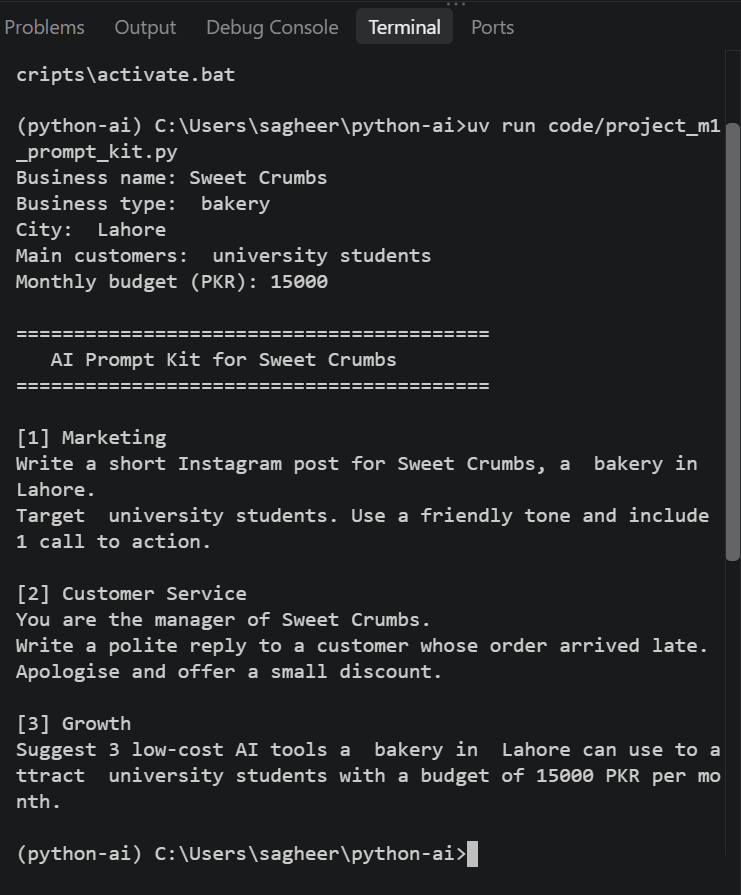

# Python AI

## Student
Maryam Yahya

## Course
Python for AI

## AI Goal
My goal is to become an Applied AI Engineer and build practical AI solutions.

## How to Run

```bash
uv run main.py

## Module 1 Project: AI Prompt Kit

A Python tool that turns a local business's details into 3 ready-to-use AI prompts.

**Run:**

```bash
uv run code/project_m1_prompt_kit.py
```



**Who would pay for this:** Small business owners who want to use AI for marketing, customer service, and business growth but do not know what to type.

## Lesson 1.8 - Business Helper Bot Design

**Business:** Sweet Crumbs Bakery

| Intent | Keywords | Reply |
|---|---|---|
| Complaint | refund, complaint, late | A manager will contact the customer |
| Opening hours | hour, open, time | Open 9 am to 10 pm |
| Prices | price, cost, how much | Cakes and cupcake prices |
| Location | where, location, address | Main Boulevard, Lahore |
| Ordering | order, delivery | Order through WhatsApp |
| Greeting | hi, hello, salam | Friendly greeting |
| Exit | bye, exit | Goodbye and chat summary |
| Anything else | no match | AI prompt fallback |

## Module 1 Checkpoint 2 — AI Front Desk

### Project Description

AI Front Desk is a rule-based front desk assistant for Sweet Crumbs bakery. It answers common customer questions for free, calculates exact price quotes, and prepares AI-ready prompts for questions that the rules cannot answer.

### Run

```bash
uv run code/project_m1_front_desk.py
Value to the Owner
This tool saves staff time by answering repeated questions automatically and reduces pricing mistakes by calculating discounts and delivery fees with Python. The owner would pay for it because it handles routine questions for free and only uses AI when needed.


README mein **project name + one-line description + run command + screenshot + value line** mandatory hain. :chatgpt-content-reference{index="17"}

---

# 25. STEP 9 — Git check

Terminal:

```bat
cd C:\Users\sagheer\python-ai